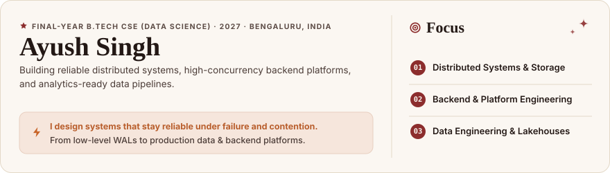
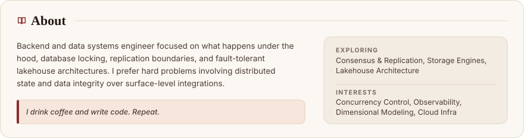
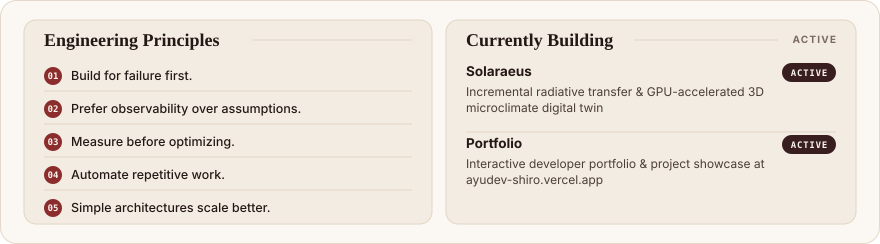
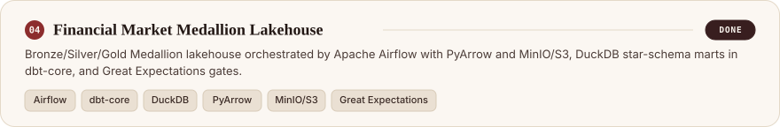
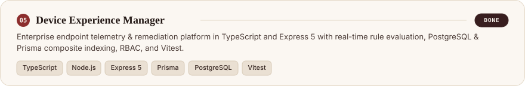
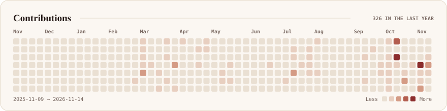
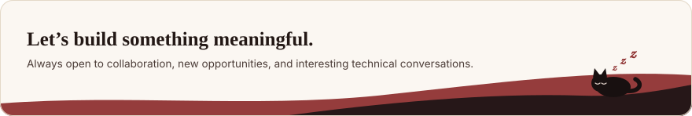

<!-- Generated by generate.py from profile.json -- edit those, not this file. -->

<picture><source media="(prefers-color-scheme: dark)" srcset="assets/cards/dark/header.svg"></picture>

<a href="#about"><picture><source media="(prefers-color-scheme: dark)" srcset="assets/cards/dark/nav_about.svg"></picture></a> <a href="#tech-stack"><picture><source media="(prefers-color-scheme: dark)" srcset="assets/cards/dark/nav_stack.svg"></picture></a> <a href="#featured-projects"><picture><source media="(prefers-color-scheme: dark)" srcset="assets/cards/dark/nav_projects.svg"></picture></a> <a href="#certifications"><picture><source media="(prefers-color-scheme: dark)" srcset="assets/cards/dark/nav_certs.svg"></picture></a> <a href="#github-analytics"><picture><source media="(prefers-color-scheme: dark)" srcset="assets/cards/dark/nav_analytics.svg"></picture></a>

<picture><source media="(prefers-color-scheme: dark)" srcset="assets/cards/dark/hero.svg"></picture>

<a href="mailto:ayushsingh2005811@gmail.com"><picture><source media="(prefers-color-scheme: dark)" srcset="assets/cards/dark/action_email.svg"></picture></a> 
<a href="https://ayudev-shiro.vercel.app"><picture><source media="(prefers-color-scheme: dark)" srcset="assets/cards/dark/action_portfolio.svg"></picture></a>

<picture><source media="(prefers-color-scheme: dark)" srcset="assets/cards/dark/info.svg"></picture>

<h2 align="center">About</h2>

<picture><source media="(prefers-color-scheme: dark)" srcset="assets/cards/dark/about.svg"></picture>

<picture><source media="(prefers-color-scheme: dark)" srcset="assets/cards/dark/principles_building.svg"></picture>

<h2 align="center">Tech Stack</h2>

<picture><source media="(prefers-color-scheme: dark)" srcset="assets/cards/dark/stack.svg"></picture>

<h2 align="center">Featured Projects</h2>

<a href="https://github.com/ayushsingh08-ds/traceguard"><picture><source media="(prefers-color-scheme: dark)" srcset="assets/cards/dark/project_0.svg"></picture></a>

<a href="https://github.com/ayushsingh08-ds/Switchyard"><picture><source media="(prefers-color-scheme: dark)" srcset="assets/cards/dark/project_1.svg"></picture></a>

<a href="https://github.com/ayushsingh08-ds/notification-queue-service-with-reliability-guarantees"><picture><source media="(prefers-color-scheme: dark)" srcset="assets/cards/dark/project_2.svg"></picture></a>

<a href="https://github.com/ayushsingh08-ds/financial-market-lakehouse"><picture><source media="(prefers-color-scheme: dark)" srcset="assets/cards/dark/project_3.svg"></picture></a>

<a href="https://github.com/ayushsingh08-ds/device-experience-manager"><picture><source media="(prefers-color-scheme: dark)" srcset="assets/cards/dark/project_4.svg"></picture></a>

<a href="https://github.com/ayushsingh08-ds/fluffy-broccoli"><picture><source media="(prefers-color-scheme: dark)" srcset="assets/cards/dark/project_5.svg"></picture></a>

<a href="https://github.com/ayushsingh08-ds?tab=repositories">View all repositories &rarr;</a>

<h2 align="center">Certifications</h2>

<picture><source media="(prefers-color-scheme: dark)" srcset="assets/cards/dark/certifications.svg"></picture>

<h2 align="center">GitHub Analytics</h2>

<picture><source media="(prefers-color-scheme: dark)" srcset="assets/cards/dark/analytics.svg"></picture>

<picture><source media="(prefers-color-scheme: dark)" srcset="assets/cards/dark/contrib.svg"></picture>

<picture><source media="(prefers-color-scheme: dark)" srcset="assets/cards/dark/closing.svg"></picture>

<a href="https://github.com/ayushsingh08-ds">GitHub</a> · <a href="https://ayudev-shiro.vercel.app">Portfolio</a> · <a href="https://www.linkedin.com/in/ayush-singh-b7760a224/">LinkedIn</a> · <a href="mailto:ayushsingh2005811@gmail.com">Email</a> · <a href="https://drive.google.com/file/d/1ZtA7NnBvqgq2d3lZ_0J9q3f2qWJ1-T5X/view?usp=sharing">Resume</a>

